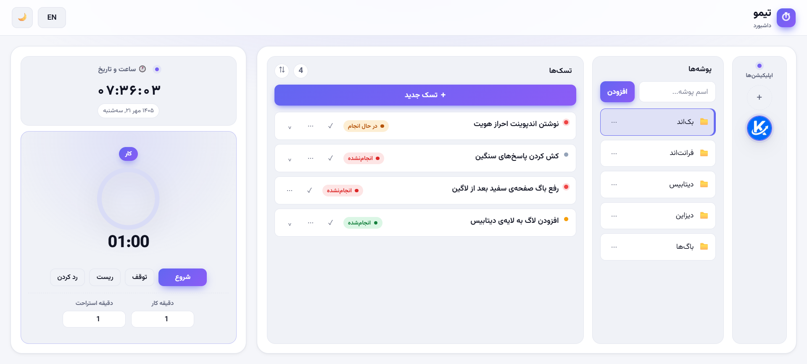

# Timo

> 📖 [نسخه فارسی](./README.fa.md)

Task manager for developers: an `Application → Folder → Task` dashboard in plain PHP + MySQL, bilingual FA/EN, with a Pomodoro timer whose settings live in the database.

[](https://github.com/AmirBahadorAmiri/Timo/tree/v1.0)
[](https://www.php.net/)
[](https://dev.mysql.com/doc/)
[](https://developer.mozilla.org/docs/Web/JavaScript)

## 📸 Screenshot



## ✨ Features

### 🗂 Organization
- `Application → Folder → Task` hierarchy, everything cascade-deleted with its parent
- Circular app rail: per-app logo, gradient first-letter fallback when no logo is set
- Floating name tooltip on app hover

### ✅ Tasks
- One shared dialog for create **and** edit — title, description, priority, status
- Statuses `todo` / `doing` / `done`, priorities `low` / `medium` / `high`
- Sort menu beside the counter: newest, oldest, priority, status, A–Z (choice is persisted)
- Coloured status dot on every badge: red = todo, amber = doing, green = done
- Click a row to expand its description

### 🎨 Interface
- Bilingual FA/EN with full RTL support
- Light / dark theme; colour tokens are registered with `@property` so the switch animates
- Right-click context menus and native `<dialog>` modals
- Responsive: single column under 1100px wide, compact layout under 840px tall

### ⏱ Pomodoro
- Single timer alternating Work ⇄ Break
- Work/break minutes stored in MySQL (`settings` table) and cached in `localStorage`
- Gradient ring that fills up as the time runs out
- Sound + Notification at the end; the next mode is armed but never auto-starts

### 🔌 API
- `applications.php`, `folders.php`, `tasks.php`, `settings.php`
- `_method` override, so forms can send `PATCH` / `DELETE` over `POST`

## 🛠 Tech Stack

| Layer | Tool |
|---|---|
| Backend | PHP 8.2 — PDO, no framework |
| Database | MySQL / MariaDB, `utf8mb4` |
| Front-end | Vanilla JS, no build step |
| Styling | Hand-written CSS, `@property` colour tokens |
| Server | Apache (XAMPP) |

## 📁 Project Structure

```text
Timo/
├── index.php             dashboard shell + language bootstrap
├── config/
│   └── config.php        DB constants, PDO + JSON helpers, logo upload
├── api/
│   ├── applications.php  CRUD (+ logo file cleanup on delete)
│   ├── folders.php       CRUD
│   ├── tasks.php         CRUD
│   └── settings.php      GET / POST timer minutes
├── assets/
│   ├── css/
│   │   ├── style.css     design system, themes, layout, modals, menus
│   │   └── pomotroid.css timer card
│   └── js/
│       ├── app.js        apps, folders, tasks, sorting
│       ├── modal.js      generic <dialog> form + confirm box
│       ├── contextmenu.js right-click menu
│       ├── pomotroid.js  the timer
│       ├── widgets.js    clock & date card
│       └── i18n.js       t(key) lookup
├── lang/
│   ├── fa.php            63 keys
│   └── en.php            63 keys
├── database/
│   └── schema.sql        tables + idempotent `logo` column migration
├── screenshot/
│   └── screenshot.png    dashboard preview used by this README
└── uploads/              app logos at runtime (only .htaccess is committed)
```

## 🚀 Setup & Run

**1. Clone**

```bash
git clone https://github.com/AmirBahadorAmiri/Timo.git
```

**2. Put it inside XAMPP's `htdocs`**

```cmd
move Timo C:\xampp\htdocs\www\
```

**3. Start Apache and MySQL** from the XAMPP control panel.

**4. Create and fill the database** — `schema.sql` creates the database itself, so one command is enough:

```cmd
C:\xampp\mysql\bin\mysql.exe -u root --default-character-set=utf8mb4 < database\schema.sql
```

**5. Open** [http://localhost/Timo/index.php](http://localhost/Timo/index.php)

> Credentials live in `config/config.php` and default to XAMPP's `root` with an empty password.

## 📋 Requirements

- XAMPP with Apache, PHP 8 and MySQL/MariaDB
- Default XAMPP database credentials (`root`, empty password)
- A Chromium- or Firefox-based browser (the UI uses `<dialog>`, `@property` and `color-mix`)

---

Made with ❤️ by Amir